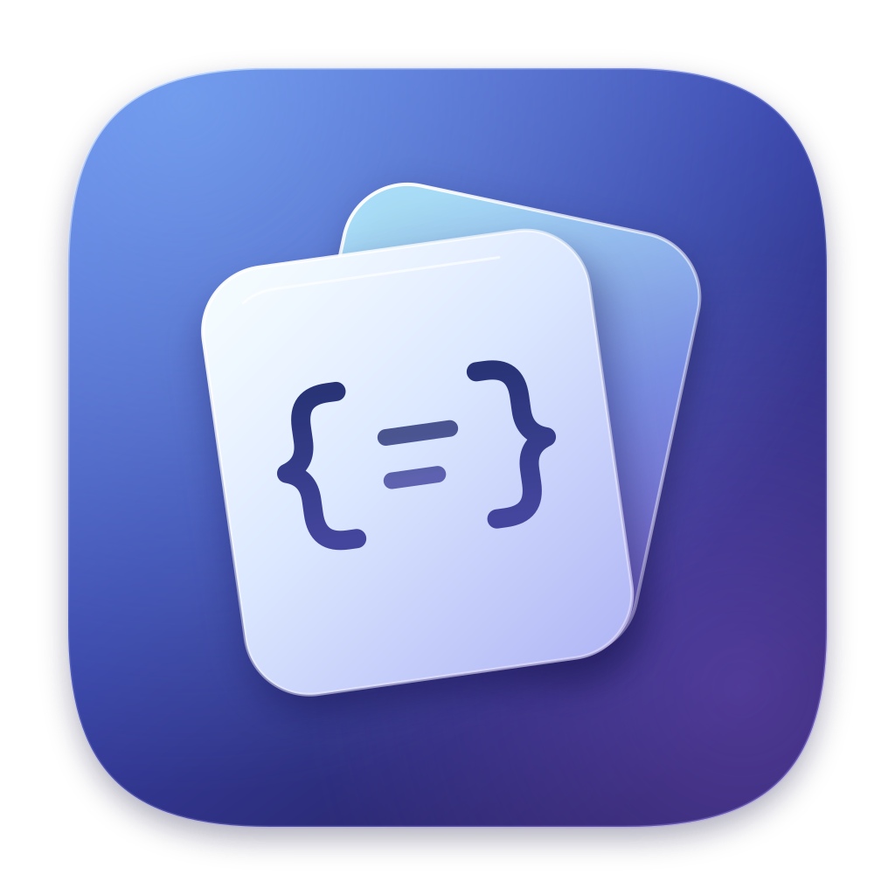

# TinyRefs



TinyRefs is a lightweight macOS app for organizing references, bibliographies,
and PDF attachments. It includes a command-line tool and is a work in progress.

## How it works

The SwiftUI app and CLI share a local library at
`~/Library/Application Support/TinyRefs` by default. SQLite stores references
and collections, while managed copies of attached files live in `attachments/`.
The app opens PDFs in Preview. A Rust library reads and writes BibLaTeX
(`.bib`) files and preserves custom fields during import and export.

## Build

TinyRefs runs on macOS 26 or later. To build it, use Swift 6.4 or later,
a macOS 26 or later SDK, and a Rust toolchain that supports the 2024 edition.

```sh
make bundle
open .build/TinyRefs.app
```

`make bundle` builds and locally signs the release app. `make cli` builds the
release CLI at `.build/release/tinyrefs`. Run `make build` for a debug build,
`make test` to run the Rust and Swift tests, or `make clean` to remove build
outputs, including the app bundle. SwiftPM also clears custom files and caches
placed in `.build`.

## CLI usage

Build the CLI, then import an existing bibliography, search the library, or
export it to a new file.

```sh
make cli
tinyrefs=.build/release/tinyrefs
"$tinyrefs" import references.bib
"$tinyrefs" query Haskell
"$tinyrefs" export library.bib
"$tinyrefs" --help
```
